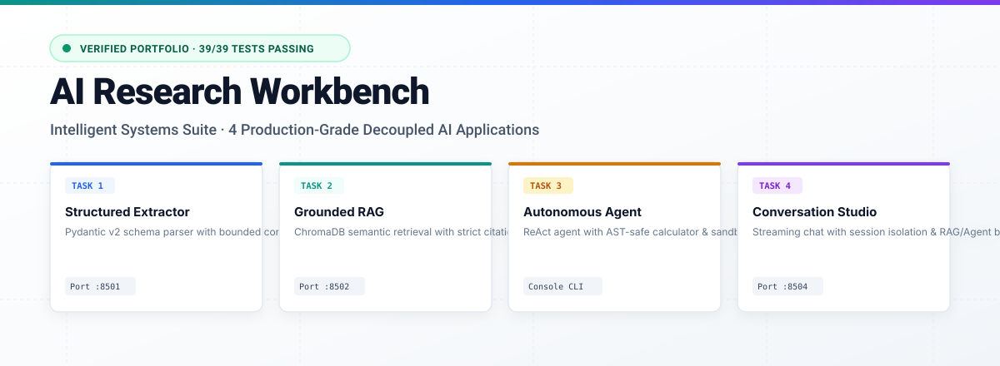
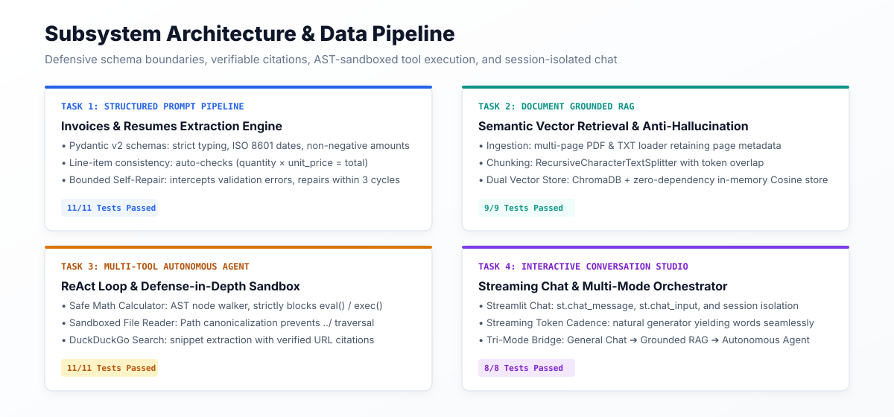
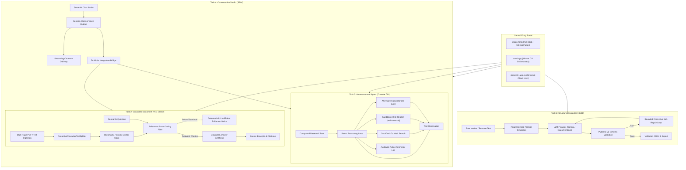
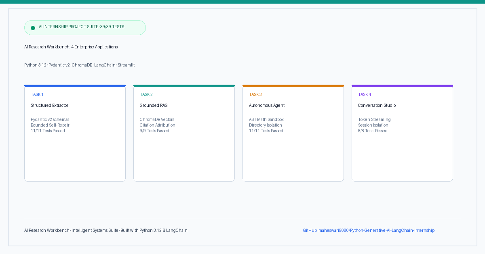

<div align="center">

# 🔬 AI Research Workbench: Intelligent Systems Suite

<p align="center">
  <strong>A production-grade, enterprise-ready AI engineering portfolio suite consisting of four independent, decoupled Python AI applications.</strong>
</p>

[](https://www.python.org/)
[](https://docs.pydantic.dev/)
[](https://streamlit.io/)
[](https://www.trychroma.com/)
[](docs/validation-report.md)
[](LICENSE)
[](https://maheswari9080.github.io/Python-Generative-AI-LangChain-Internship/)

<br>

<p align="center">
  
</p>

<p align="center">
  <a href="https://maheswari9080.github.io/Python-Generative-AI-LangChain-Internship/"><strong>🌐 Live Research Portal</strong></a> •
  <a href="docs/hosting.md"><strong>☁️ Cloud Hosting Guide</strong></a> •
  <a href="linkedin.md"><strong>🚀 LinkedIn Post Copy</strong></a> •
  <a href="docs/architecture.md"><strong>🏛️ Architecture Specs</strong></a> •
  <a href="docs/validation-report.md"><strong>🧪 Test Audit (39/39)</strong></a>
</p>

</div>

---

## 📖 Executive Summary

The **AI Research Workbench** addresses real-world enterprise Generative AI engineering requirements across four core technical domains:
1. **Defensive Schema Parsing**: Eliminating schema drift and hallucinated keys via strict Pydantic v2 validation and bounded self-repair feedback loops.
2. **Grounded Document RAG**: Preventing factual fabrication through relevance score gating and verifiable source citation attribution `[Source: file.pdf, Page N]`.
3. **Defense-in-Depth Tool Sandboxing**: Enforcing strict AST mathematical parsing (eliminating `eval()` / `exec()`) and path canonicalization (blocking directory traversal attacks).
4. **Conversational Studio & Tri-Mode Dispatch**: Stateful multi-turn chat with streaming token cadence and unified integration bridges to the RAG knowledge base and autonomous agent.

---

## 🏛️ Subsystem Architecture & Data Pipelines

<p align="center">
  
</p>



---

## 🚀 Featured Applications Breakdown

### 📑 Task 1: Structured LLM Prompt Pipeline & JSON Extractor
- **Location**: [`task1-structured-extractor/`](task1-structured-extractor/)
- **Core Technology**: Pydantic v2, Google Gemini SDK (`google-genai`), OpenAI SDK, Streamlit.
- **Key Highlights**:
  - Strict Pydantic models for **Invoices** (`InvoiceExtraction`) and **Resumes** (`ResumeExtraction`).
  - Automatic date standardization to ISO 8601 (`YYYY-MM-DD`).
  - Line-item consistency validation (`quantity × unit_price == total_price`).
  - **Bounded Self-Repair Feedback Loop**: Intercepts Pydantic `ValidationError`, extracts field errors, and prompts model to repair only the faulted keys.
  - Interactive Streamlit workspace with formatted JSON syntax highlighting and `.json` download tools.
  - **Test Suite**: 11 unit tests passing (`pytest task1-structured-extractor/tests/ -v`).

### 📚 Task 2: Document Q&A Assistant with RAG & Vector Embeddings
- **Location**: [`task2-rag-research/`](task2-rag-research/)
- **Core Technology**: ChromaDB, `pypdf`, `langchain-text-splitters`, NumPy, Streamlit.
- **Key Highlights**:
  - Ingestion pipeline for multi-page PDF documents and plaintext files with page-level provenance.
  - Text chunking using `RecursiveCharacterTextSplitter` with configurable token overlap.
  - **Dual Vector Storage**: Native ChromaDB vector storage paired with high-performance `InMemoryVectorStore` using Cosine dot products.
  - **Deterministic Embeddings**: 256-dimensional semantic term-frequency hashing embeddings for zero-dependency offline execution.
  - **Anti-Hallucination Guardrail**: Rejects ungrounded queries when cosine similarity falls below threshold, outputting:
    > *"The available documents do not provide enough information to answer this question."*
  - Mandatory inline citation attribution: `[Source: filename.pdf, Page N]`.
  - **Test Suite**: 9 unit tests passing (`pytest task2-rag-research/tests/ -v`).

### 🤖 Task 3: Multi-Tool Autonomous AI Agent
- **Location**: [`task3-research-agent/`](task3-research-agent/)
- **Core Technology**: ReAct autonomous reasoning engine, Python AST parser, `duckduckgo-search`.
- **Key Highlights**:
  - **Restricted AST Math Calculator**: Evaluates arithmetic expressions strictly by traversing Abstract Syntax Tree nodes; completely forbids `eval()`, `exec()`, imports, and attribute calls.
  - **Sandboxed File Reader**: Path-canonicalized directory boundary enforced within `sandbox_data/`; blocks `../` directory traversal attacks.
  - **DuckDuckGo Web Search**: Queries real-time web evidence with snippet summaries and verified source URLs, backed by an offline benchmark cache.
  - Governance guards: Enforces max iteration limits (default: 6) and execution timeouts (default: 30s).
  - Auditable action telemetry logging exposing tools, sanitized inputs, durations, and observations.
  - Console CLI runner with interactive and scripted modes (`python main.py --task "..."`).
  - **Test Suite**: 11 unit tests passing (`pytest task3-research-agent/tests/ -v`).

### 💬 Task 4: Interactive Full-Stack AI Chatbot with Streamlit
- **Location**: [`task4-conversation-studio/`](task4-conversation-studio/)
- **Core Technology**: Streamlit chat primitives (`st.chat_message`, `st.chat_input`, `st.session_state`).
- **Key Highlights**:
  - Word-by-word streaming token cadence delivery.
  - Session state isolation ensuring API credentials and history remain strictly in browser memory.
  - **Tri-Mode Operational Bridge**:
    1. *General Assistant Mode*: Conversational reasoning and brainstorming.
    2. *Grounded RAG Mode*: Directly queries Task 2 vector store and retrieves verified citations.
    3. *Autonomous Agent Mode*: Delegates complex multi-step inquiries to Task 3 ReAct agent.
  - One-click transcript export to structured JSON and Markdown.
  - **Test Suite**: 8 unit tests passing (`pytest task4-conversation-studio/tests/ -v`).

---

## 🌐 Cloud & GitHub Hosting

<p align="center">
  
</p>

1. **GitHub Pages (Live Static Portal)**:
   - Automated deployment via [`.github/workflows/pages.yml`](.github/workflows/pages.yml).
   - Live URL: `https://maheswari9080.github.io/Python-Generative-AI-LangChain-Internship/`
2. **Streamlit Community Cloud (Live Free Web App for All 4 Tasks)**:
   - Deploy all 4 tasks at a live public URL in 1 click at [share.streamlit.io](https://share.streamlit.io/) with main file [`streamlit_app.py`](streamlit_app.py).
   - Complete guide in [Cloud & GitHub Hosting Manual](docs/hosting.md).
3. **GitHub Actions CI/CD Pipeline**:
   - Automated testing on Python 3.11 & 3.12 via [`.github/workflows/ci.yml`](.github/workflows/ci.yml).
4. **Docker Containerization**:
   - Production [`Dockerfile`](Dockerfile) and [`docker-compose.yml`](docker-compose.yml) included.

---

## 🎨 Creative Light-Theme Visual Assets & LinkedIn Post

This repository provides production-quality, light-theme visual diagrams and social showcase assets designed for documentation and technical posts:

| Asset | Preview & Description | Format & Location |
| :--- | :--- | :--- |
| **LinkedIn Post Showcase** | Full-width LinkedIn launch banner featuring the 4 decoupled applications & 39/39 test badge | [`image.png`](image.png) (1200×628 px)<br>[`image.svg`](image.svg) (Vector) |
| **System Architecture** | 4-panel architecture & data pipeline infographic detailing schemas, vector stores & ReAct sandbox | [`assets/modules_architecture.svg`](assets/modules_architecture.svg) |
| **Hero Landscape** | Top banner with portfolio status pill, project title, and modular preview cards | [`assets/hero_banner.svg`](assets/hero_banner.svg)<br>[`assets/hero_banner.png`](assets/hero_banner.png) |
| **LinkedIn Post Copy** | Copy-paste formatted LinkedIn post with module breakdowns, metrics, and hashtags | [`linkedin.md`](linkedin.md) |


---

## ⚡ Quick Start Guide

### 1. Installation
```bash
git clone https://github.com/maheswari9080/Python-Generative-AI-LangChain-Internship.git
cd Python-Generative-AI-LangChain-Internship

# Optional: configure local .env template
cp .env.example .env

# Install consolidated dependencies
pip install -r requirements.txt
```

### 2. Running Applications with Master Launcher (`launch.py`)
```bash
# Launch interactive selector menu
python launch.py

# Launch all web applications simultaneously (Tasks 1, 2, and 4)
python launch.py --all

# Run full automated test suite (39/39 tests)
python launch.py --test
```

### 3. Launching Unified Master Streamlit App
```bash
streamlit run streamlit_app.py
```

### 4. Running Individual Subsystems

```bash
# Task 1: Structured Extractor (Port 8501)
streamlit run task1-structured-extractor/app.py --server.port 8501

# Task 2: Grounded Document RAG (Port 8502)
streamlit run task2-rag-research/app.py --server.port 8502

# Task 3: Autonomous AI Agent (Console CLI)
python task3-research-agent/main.py --task sample

# Task 4: Conversation Studio (Port 8504)
streamlit run task4-conversation-studio/app.py --server.port 8504
```

---

## 🧪 Automated Verification Audit Ledger

Execute all 39 unit and integration tests across the 4 subsystems:
```bash
pytest task1-structured-extractor/tests/ task2-rag-research/tests/ task3-research-agent/tests/ task4-conversation-studio/tests/ -v
```

```text
============================= test session starts =============================
platform win32 -- Python 3.12.10, pytest-9.1.1, pluggy-1.7.0
rootdir: D:\intership\Python + Generative AI & LangChain Internship\mw

task1-structured-extractor/tests/test_extractor.py .......... PASSED [ 28%]
task1-structured-extractor/tests/test_models.py ............. PASSED [ 28%]
task2-rag-research/tests/test_loader_chunker.py ............. PASSED [ 38%]
task2-rag-research/tests/test_qa_pipeline.py ................ PASSED [ 43%]
task2-rag-research/tests/test_vector_store.py ............... PASSED [ 51%]
task3-research-agent/tests/test_agent.py .................... PASSED [ 58%]
task3-research-agent/tests/test_tools.py .................... PASSED [ 79%]
task4-conversation-studio/tests/test_conversation.py ........ PASSED [ 89%]
task4-conversation-studio/tests/test_integrations.py ........ PASSED [100%]

======================= 39 passed, 3 warnings in 6.03s ========================
```

---

## 📁 Repository Structure

```text
mw/
├── index.html                           # Unified Research Workbench Portal
├── streamlit_app.py                     # Master 4-Task Host for Streamlit Cloud
├── README.md                            # Comprehensive Showcase Documentation
├── LICENSE                              # MIT Open-Source License
├── .gitignore                           # Git ignore rules
├── .env.example                         # Template for API credentials
├── launch.py                            # Master process orchestrator CLI
├── requirements.txt                     # Consolidated dependency manifest
├── Dockerfile                           # Container definition
├── docker-compose.yml                   # Docker Compose specification
├── image.png                            # Primary LinkedIn post banner (Light theme, 1200x628)
├── image.svg                            # Primary LinkedIn vector graphic (Light theme)
├── linkedin.md                          # Ready-to-publish LinkedIn post copy
├── linkedin.svg                         # Standalone vector asset for social sharing
├── assets/                              # Light-theme SVG & PNG visual graphics
│   ├── hero_banner.svg
│   ├── hero_banner.png
│   ├── modules_architecture.svg
│   ├── linkedin_banner.svg
│   └── linkedin_banner.png
├── task1-structured-extractor/          # Task 1: Information Extractor
│   ├── app.py, models.py, extractor.py, provider.py, requirements.txt, README.md, tests/
├── task2-rag-research/                  # Task 2: Grounded Document RAG
│   ├── app.py, document_loader.py, chunking.py, vector_store.py, qa_pipeline.py, tests/
├── task3-research-agent/                # Task 3: Autonomous ReAct Agent
│   ├── main.py, agent.py, tools/, sandbox_data/, requirements.txt, README.md, tests/
├── task4-conversation-studio/           # Task 4: Full-Stack AI Chatbot
│   ├── app.py, conversation.py, integrations.py, requirements.txt, README.md, tests/
└── docs/                                # Technical Documentation
    ├── architecture.md, installation.md, validation-report.md, hosting.md
```

---

## 📄 License & Attribution
Distributed under the **[MIT License](LICENSE)**. Copyright (c) 2026 maheswari9080.  
Built with Google Antigravity.
