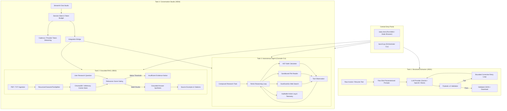

# AI Research Workbench: System Architecture & Data Flow

## 1. Architectural Philosophy & Design Principles
The **AI Research Workbench** is designed as a modular, decoupled suite of four independent Python AI subsystems.
Each subsystem is self-contained with its own models, pipelines, user interfaces, dependency manifests, and automated test fixtures.

### Core Architectural Tenets:
1. **Defensive Schema Boundaries**: Model completions are never trusted unconditionally; strict Pydantic v2 schemas govern all structured ingestion and extraction boundaries.
2. **Grounded Retrieval & Anti-Hallucination Guardrails**: Document Q&A enforces explicit threshold gating and citation provenance attribution. When evidence is insufficient, answers default to deterministic unanswerability statements rather than speculative generation.
3. **Defense-in-Depth Tool Sandboxing**: Agents interact with the local operating system and arithmetic capabilities only through sandboxed AST evaluators and path-canonicalized directory limits. Raw `eval()` or unconstrained shell calls are strictly banned.
4. **Resilient Offline Decoupling**: All modules feature deterministic offline mock engines and local vector embeddings, ensuring that evaluation, CI/CD pipelines, and local unit test suites run with 100% predictability even when network connectivity or remote API keys are absent.

---

## 2. Global Architecture Diagram

---

## 3. Subsystem Breakdown & Implementation Decisions

### Task 1: Structured Extractor
- **Pydantic v2 Models**: `InvoiceExtraction` and `ResumeExtraction` enforce ISO 8601 date parsing (`YYYY-MM-DD`), non-negative currency amounts, and line-item summation validation (`quantity * unit_price = total_price`).
- **Self-Repair Feedback Loop**: Intercepts `ValidationError`, extracts field location and error string, and constructs a corrective repair prompt providing the LLM with previous faulty output, validation messages, and original document text. Configurable up to 5 bounded retries.

### Task 2: Grounded Document RAG
- **Provenance Preservation**: `document_loader.py` captures `source`, `filename`, `page_number`, `char_count`.
- **Hybrid Embeddings**: Supports local deterministic 256-d hashing embeddings (zero external API calls), Gemini `text-embedding-004`, and OpenAI `text-embedding-3-small`.
- **Threshold Gating**: Any candidate chunk scoring below `min_relevance_score` is discarded before prompt synthesis, preventing hallucinations on out-of-scope inquiries.

### Task 3: Autonomous AI Agent
- **AST Mathematical Evaluation**: Recursively walks parsed Abstract Syntax Tree nodes (`ast.parse`), permitting only mathematical operators and standard functions (`sqrt`, `log`, `sin`, `round`). Rejects variable access, imports, and system calls.
- **Directory Traversal Defense**: Canonicalizes relative file paths against an absolute `sandbox_data/` boundary using `Path.resolve()` and `relative_to()` validation.
- **Auditable Observability**: Separates public action-observation logs from internal reasoning tokens, producing clean verification tables suitable for enterprise auditing.

### Task 4: Conversation Studio
- **Full-Stack Chat Primitives**: Implements Streamlit `st.chat_message`, `st.chat_input`, and `st.session_state`.
- **Tri-Mode Dispatcher**: Seamlessly connects user messages to general conversation, Task 2 RAG vector collections, or Task 3 multi-tool autonomous execution.
- **Session Privacy**: API keys remain in transient browser session state and are never written to disk or logs.
